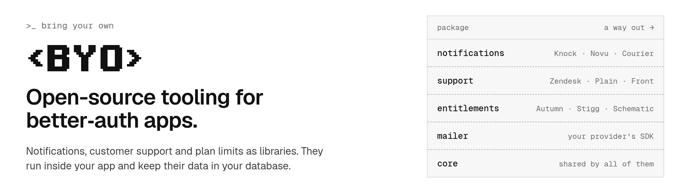
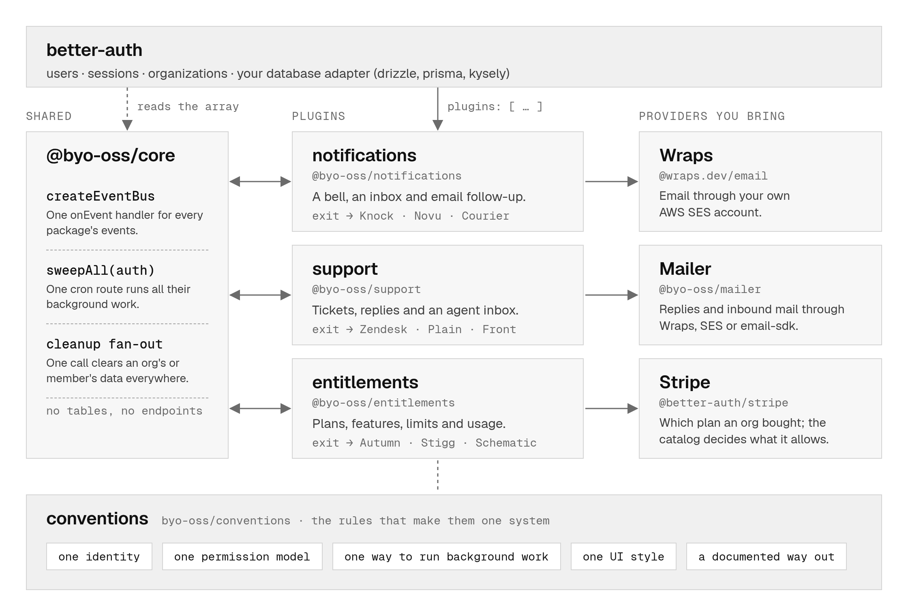

<p align="center">
  <a href="https://byo.dev">
    <picture>
      <source media="(prefers-color-scheme: dark)" srcset="https://raw.githubusercontent.com/byo-oss/.github/main/profile/assets/banner-dark.png">
      
    </picture>
  </a>
</p>

**BYO** is a set of open-source packages for [better-auth](https://better-auth.com) apps. If you run better-auth and you're about to rent Knock, Zendesk or Stigg, or hand-roll your own, this is the library version. Notifications, support and plan limits run inside your app and keep their data in your database. They need better-auth 1.7.16 or newer.

[**byo.dev**](https://byo.dev) · [Docs](https://byo.dev/docs) · [Conventions](https://byo.dev/conventions) · [npm](https://www.npmjs.com/org/byo-oss)

## Which package solves my problem?

| You want to... | Package | When you outgrow it | |
|---|---|---|---|
| tell users something happened in your app | [`@byo-oss/notifications`](https://github.com/byo-oss/notifications): a bell, an inbox and email follow-up for anything that went unread. Opt-in web push | Knock · Novu · Courier |  [Docs](https://byo.dev/docs/notifications/quickstart) |
| let customers ask for help, and give staff a queue | [`@byo-oss/support`](https://github.com/byo-oss/support): tickets, contacts and agent replies inside your app | Zendesk · Plain · Front |  [Docs](https://byo.dev/docs/support/quickstart) |
| stop scattering plan names and limits across your API, web app and pricing page | [`@byo-oss/entitlements`](https://github.com/byo-oss/entitlements): plans, features, limits and usage from one typed catalog | Stripe Entitlements · Autumn · Schematic · Stigg |  [Docs](https://byo.dev/docs/entitlements/quickstart) |
| send email from your own plugin code | [`@byo-oss/mailer`](https://github.com/byo-oss/mailer): the email sender the packages share (Wraps, SES or email-sdk) | your provider's SDK |  [Docs](https://byo.dev/docs/mailer/introduction) |
| run two or more of the above | [`@byo-oss/core`](https://github.com/byo-oss/core): one event bus, one cron route and one org-cleanup call | |  |

## How hard is it to try?

Install one package, add it to `plugins`, migrate, drop in the component. Each quickstart above is a handful of steps. A second package is one more line:

```ts
const onEvent = createEventBus([(event) => console.log(event.type)]); // @byo-oss/core

export const auth = betterAuth({
  plugins: [
    organization(), // first: the others' tables reference it
    inbox({ onEvent }),
    support({ staffOrganizationId: process.env.STAFF_ORGANIZATION_ID, onEvent }), // the org your agents belong to
  ],
});
```

The rest is on [byo.dev](https://byo.dev/docs). With a coding agent, these install a skill that walks it through setup:

```sh
npx skills add byo-oss/notifications
npx skills add byo-oss/support
npx skills add byo-oss/entitlements
```

## Will they work together?

<p align="center">
  <picture>
    <source media="(prefers-color-scheme: dark)" srcset="https://raw.githubusercontent.com/byo-oss/.github/main/profile/assets/how-it-fits-dark.png">
    
  </picture>
</p>

- **One identity.** Every package is addressed to your better-auth users and organizations. Call `deleteOrganizationData` and `deleteMemberData` from `@byo-oss/core` in your `organization()` hooks and every installed package clears its rows.
- **One event stream.** Packages emit events after the write commits (`support.ticket.created`, `notifications.delivery.failed`). Pass the same `onEvent` to each plugin and send events where you like.
- **One cron route.** Delayed email, retries and auto-closing need background work. Call `sweepAll(auth)` from one cron route and it runs every installed package's work.

The [conventions](https://github.com/byo-oss/conventions/blob/main/SPEC.md) are what make them one system.

## Can I trust it, and can I leave?

- Your data stays in your database. Libraries, not services: nothing to sign up for or deploy.
- MIT licensed. Community project, not affiliated with the better-auth team.
- Notifications, support and entitlements each ship a JSON data export, a documented schema, a clean uninstall and a mapping to the tools in the table above.
- Security reports go through the [security policy](https://github.com/byo-oss/.github/blob/main/SECURITY.md).
- Pre-1.0. Every package is on 0.x and minor releases can break things. Pin versions and read each repo's GitHub release notes before you bump.

## Where do I ask or contribute?

Open an issue on the package repo. For a question about how packages work together, use [conventions](https://github.com/byo-oss/conventions/issues).
